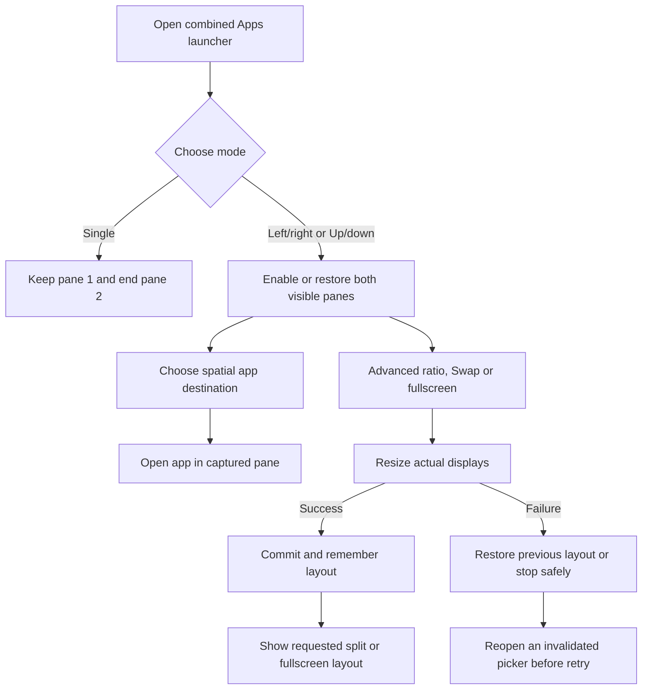

# Feature Specification: Split view

**Feature Branch**: `feature/split-view`

**Created**: 2026-10-16

**Status**: Implemented locally; device verification and remaining gaps are recorded in
[test evidence (evidence withdrawn)](../../testresults/README.md).

**Input**: Promote the two-managed-display experiment into DexDroid after the user
reported that a Bluetooth keyboard worked as expected.

See the [feature index](README.md) for the other existing contracts and the
[testing runbook](../TESTING.md) to reproduce checks with another device.

## User Scenarios & Testing

### User Story 1 - Use two apps together (Priority: P1)

Choose Layout from the control panel on either screen and directly open an app
for the desired spatial target. Touch or click an app pane to select its controls.

**Why this priority**: Independent live apps are the core multitasking outcome.

**Independent Test**: Two distinct native fixtures show different display IDs and
receive input independently; opening a private reader child keeps the other app usable.

**Acceptance Scenarios**:

1. **Given** a running app, **When** split view starts, **Then** it remains in pane
   1 and pane 2 offers Apps; choosing another app fills pane 2.
2. **Given** two apps, **When** the selected app changes, **Then** Back, phone
   gestures, scrolling and save/reset apply to that app, without changing the other.
   Child toolbar Up and system/remote Back follow the selected app's native history.
   Ending its root empties only that pane; the other pane still accepts fresh input.
   These monitor interactions preserve the phone's existing foreground Activity,
   including a visible DexDroid controller or another deliberately opened phone app.
3. **Given** split view, **When** I drag the divider or choose a ratio/direction,
   **Then** actual app dimensions change and fresh input remains aligned.
4. **Given** two apps, **When** I swap or maximize/restore a pane, **Then** their
   display/task identities remain attached to their apps and input follows position.
5. **Given** an empty pane or an app reopened on the phone, **When** its task
   departs, **Then** only that pane clears its retained pixels and offers Apps.
   If Android resumes an older task in that pane, it remains visible and becomes
   the current app for controls/settings; the other pane is unaffected.
6. **Given** single view, **When** Layout opens, **Then** it offers one Open app
   target and the split toggle, with irrelevant split controls hidden.
7. **Given** split view, **When** Layout opens, **Then** two
   Open left/right or Open up/down targets match the current direction and position;
   tapping one opens its picker directly, with destination feedback only while a
   split launch action is pressed.
8. **Given** a split launch action, **When** I press it, **Then** only its spatial destination
   highlights; release/drag cancellation, replacement, layout change or Stop clears
   the highlight. Selection launches into the captured
   pane; an obsolete picker cannot launch into a replacement session.
9. **Given** either main Apps action, **When** I open it, **Then** the shared launcher
   directly offers Single / Left-right / Up-down and a single searchable app list.
   Tapping Left/right or Up/down immediately enables two visible panes in that
   direction, including restoring the same direction from fullscreen. Single ends
   split immediately under the pane-1 retention contract. No extra toggle or app
   choice is required, and successful mode choices are remembered.
   Split app rows have Left/Right or Up/Down launch buttons; Single uses row launch.
   Opening Apps and choosing an app destination takes two actions, with no permanent
   controller additions or reduction of the phone touchpad.
10. **Given** Apps opened from Layout, **When** I Back or use its leading Up navigation,
    **Then** Layout returns; Close/outside dismisses the whole flow to the controller/desktop.
    Successful launch dismisses the menu. Nested orientation returns to its picker.

11. **Given** a phone launcher changing mode, **When** Stop/disconnect or picker
    replacement occurs before completion, **Then** the old launcher stays inert
    after completion and restart; its retained row cannot launch or take ownership.
    A failed mode change also cannot silently bind to a different layout.

12. **Given** one pane fullscreen, **When** I short-tap or keyboard/accessibility-click
    the other spatial launch action, including Swap, **Then** that pane becomes
    fullscreen and the app launches after successful resize. Merely pressing or
    cancelling does not resize/select; Stop or failed resize discards pending launch.

### User Story 2 - Use my normal input devices (Priority: P1)

Use the monitor touchscreen, phone touchpad and Bluetooth/USB keyboard and mouse
with a clearly selected pane and stable contact/key ownership.

**Why this priority**: Rendering alone is insufficient for a usable desktop.

**Independent Test**: Native click, drag, wheel, pinch, Back and keyboard metadata
checks with separate physical keyboard review. A synthetic failure stays visible.

**Acceptance Scenarios**:

1. **Given** a held contact/key, **When** it crosses a divider or selection changes,
   **Then** release/cancel reaches its original pane, with no input in another app.
2. **Given** physical touch, **When** the phone also attempts input, **Then** the
   monitor owns the sequence and touch hides the phone-generated cursor.
3. **Given** a keyboard/mouse event received by the controller host, **When** it
   is forwarded, **Then** source, buttons, modifiers and repeats are retained.
4. **Given** phone touchpad or gesture input starts on the divider, **When** I
   release or cancel, **Then** its resize completes or cancels and phone input
   remains usable. Physical takeover cancels that phone preview without committing it.
5. **Given** a monitor menu or physical contact/focus wait, **When** a mouse or
   touchpad sends input through the phone controller, **Then** the menu receives
   its pointer/wheel stream or physical ownership blocks it, without app click-through.

### User Story 3 - Keep my desktop usable (Priority: P1)

Background the phone controller, change workspace orientation/resolution, close
apps and stop/reconnect without losing control of the monitor.

**Why this priority**: Preserve existing DexDroid lifecycle and display guarantees.

**Independent Test**: Four rotations crossed with native/Fit input; preview reject;
controller background/reopen; empty pane; Stop and fresh session with zero old displays.

**Acceptance Scenarios**:

1. **Given** two apps, **When** I rotate through all four orientations or preview
   and reject a Fit configuration, **Then** both native displays and rendered app
   frames match their pane bounds, including status callbacks during resizing.
2. **Given** split view, **When** I background and reopen the controller, **Then**
   both apps and their controls remain usable on the monitor.
3. **Given** split view, **When** I Stop and start again, **Then** both old displays
   and the secondary helper terminate; fresh displays restore the remembered split
   direction, ratio and pane order, with no automatically relaunched apps.
4. **Given** an app revealed after task handoff, **When** its input window is not
   ready, **Then** a bounded worker wait and visible retry status prevent input
   misrouting; incomplete contacts/keys are discarded without stopping the other pane.
5. **Given** a new split session, **When** an obsolete helper-removal callback from
   an earlier split runs, **Then** both current displays remain and the new
   secondary app still receives native input.
6. **Given** a successfully changed layout, **When** the controller/process closes
   or the monitor reconnects, **Then** split on/off, direction, ratio and order return.
   Failed/rejected changes retain the last saved layout. End split persists single view.
7. **Given** empty or partly occupied panes, **When** I repeatedly change direction,
   ratio, Swap, fullscreen or workspace rotation, **Then** each visible empty pane
   redraws its full background and centers its icon within the new bounds, with no
   stale regions, crops or background covering an occupied app.
   Short panes hide the decorative caption when it would crowd the Apps target.
8. **Given** a fullscreen pane and the same direction chosen in Apps, **When** resize
   fails and rolls back to fullscreen, **Then** saved layout and displays remain,
   the old picker stays inert and reopening Apps permits a fresh retry.
9. **Given** an in-place launcher mode change, **When** it settles, **Then** mode
   names and app labels/icons remain readable in the captured frame, with spatial
   actions matching the resulting direction.

### Edge Cases

- Setup/resize failure reports an error and rolls back or stops cleanly.
- Rejected apps/secondary-display restrictions do not clear the other pane.
- Native app recreation on resize remains app-controlled; Android saved state is
  respected, but arbitrary third-party unsaved state cannot be guaranteed.
- Both panes use workspace rotation. Per-window independent rotation is deferred.
- Split changes are blocked during resolution confirmation and active reconfiguration.
- Protected content remains protected; its compact Help notice never obscures another pane.
- Selection is readable in status/menu values without a focus outline over either
  app, except a temporary subtle destination highlight during app choice. The
  divider is a 2 dp line with a separate 12 dp drag band; both empty panes reuse
  the single-view background. Layout lives in the main control grid; the phone pad
  centers Touchpad + Info with Back at the right, while monitor Back belongs to
  its controls header.
- Background child launches cannot move unrelated phone tasks; stale IDs never cross sessions.
- Android 11 Presentation resource/inset notifications must preserve single/split
  sessions if the actual monitor metrics remain unchanged, including forced output
  density. Genuine physical size/density/rotation changes still allow host teardown.

## Requirements

### Functional Requirements

- **FR-001**: Shared Layout controls and real app resizing (DX-WINDOWS-001 / baseline FR-031).
- **FR-002**: Per-pane input ownership and selected-app preferences (DX-WINDOWS-002 / FR-032).
- **FR-003**: Service lifecycle, profile rollback, rotation/Fit, task handoff and cleanup
  for both panes (DX-WINDOWS-003 / FR-033).

### Key Entities

- **Workspace layout**: Direction, ratio, swap order, selected and maximized pane.
- **Saved layout**: Confirmed split enabled/direction/ratio/order only; ephemeral
  selections/fullscreen, tasks, display IDs and input ownership are excluded.
- **App choice**: Session-scoped picker ownership and captured target pane, cleared
  on completion/cancel and invalidated by replacement, geometry changes or teardown.
- **Pane**: Session-scoped display, bridge, surface, app occupancy/protection and input owner.
- **Evidence**: Actual build/configuration, native versus physical input, results and gaps.

## Success Criteria

### Measurable Outcomes

- **SC-001**: App IDs remain distinct and input activates only the intended fixture.
- **SC-002**: Four rotations and Fit reject bars and preserve coordinate alignment.
- **SC-003**: Divider motion queues no per-pixel remote resize; commit changes both app sizes.
- **SC-004**: Stop removes both owned displays; stale callbacks cannot adopt a new session.
- **SC-005**: Both menus share current state/style, remain usable with keyboard/scrolling,
  and have rendered review plus explicit physical/performance gaps.

## Assumptions

- Non-root Shizuku, Android 11 minimum; Android 16/17 and OEMs require real validation.
- User reported Epomaker Split 65 Bluetooth success on the Android 11 prototype:
  typing in Chrome search, then a calendar event field, reached the correct location
  and updated the display. This is manual prototype evidence, not a production pass.
- Prototype synthetic sustained keyboard test failed, including native host injection;
  do not erase or reinterpret it as a pass. Diagnose production paths independently.
- Two different app packages; independent duplicate app instances, floating windows,
  pinned windows, saved app pairs and general keyboard mirroring are deferred.
- No release is implied by implementation; normal review/publication gates still apply.

## Feature flow

Direct mode choice and split lifecycle. This is a product-level flow; implementation ownership is in
[architecture](../ARCHITECTURE.md) and the [owning code](../../app/src/main/kotlin/dev/dexdroid/SplitWorkspace.kt).

Fullscreen and selected pane are transient. Only confirmed split enabled/direction,
ratio and pane order are durable; app tasks and display IDs are never restored as
saved layout identities.

## Implementation diagrams

See the [component overview and representative sequence](../architecture/features/split-view.md)
for source ownership, lifecycle/failure boundaries and current verification limits.
