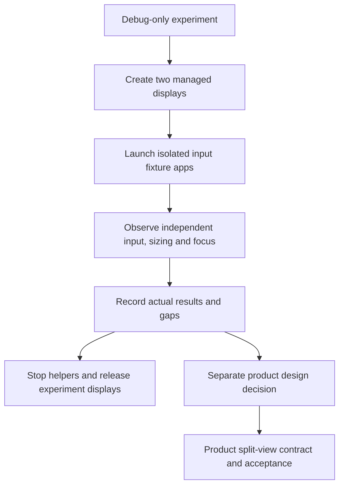

# Feature Specification: Two managed panes feasibility prototype

**Feature Branch**: `prototype/two-managed-panes`

**Created**: 2026-10-16

**Status**: Experimental; debug-only, not a product feature or release candidate.

**Input**: Prove two DexDroid-managed app displays and input routing before
committing to a split-view product architecture.

This experimental contract maps to baseline **FR-030 / DX-SPLIT-001** in
[SPEC.md](../../SPEC.md). It remains separate from the product split-view feature;
see the [feature index](README.md) for ownership and current contracts.

## User Scenarios & Testing

### User Story 1 - Use two apps together (Priority: P1)

As an experimenter I explicitly open the prototype, choose two apps and use them
on the external monitor while the normal product flow remains available.

**Why this priority**: Simultaneous visible and interactive apps are the feasibility gate.

**Independent Test**: Launch two distinct input fixtures, observe different display
IDs and independently changing content, then replace either fixture with a real app.

**Acceptance Scenarios**:

1. **Given** an unlocked phone, monitor and authorized Shizuku, **When** the
   experiment starts, **Then** two independently owned displays show distinct apps.
2. **Given** both panes, **When** I select one and type, click, drag or scroll,
   **Then** the intended pane receives the events, preserving keyboard modifiers,
   repeats and pointer source/buttons; the other app does not receive them.
3. **Given** a contact starts in one pane, **When** it crosses the divider,
   **Then** it stays with its original pane until release/cancellation.
4. **Given** both panes, **When** their split changes, **Then** app display sizes
   change and fresh input aligns with the new dimensions.
5. **Given** an active experiment, **When** Stop or monitor/host loss occurs,
   **Then** both displays and queued input are released; normal DexDroid can resume.

### Edge Cases

- Missing monitor, authorization, failed launch or dead bridge reports a visible error.
- Bounded input work rejects overflow and cancels held state rather than replaying
  a stale queue. No Binder, launch command or resize runs on the UI thread.
- User apps can reject secondary displays, migrate existing tasks or recreate when
  resized. Test two different apps; independent instances of one app are excluded.
- Physical peripherals may target the phone or monitor. Record the observed route
  and explicitly distinguish physical hardware from synthetic framework events.

## Requirements

### Functional Requirements

- **FR-001**: Explicit debug-only entry; no release component or normal-menu change.
- **FR-002**: Two service-owned display/surface/input lifetimes (DX-SPLIT-001).
- **FR-003**: Visible selected pane; preserved keyboard/pointer event semantics;
  stable contact ownership, live display resizing and complete Stop cleanup.
- **FR-004**: Use the shared monochrome ControllerStyle for experiment controls.

### Key Entities

- **Pane**: Current session/display, dimensions, surface, app and input ownership.
- **Experiment result**: Exact build/device/configuration, observable outcomes,
  screenshots, actual input source and explicit unverified scenarios.

## Success Criteria

### Measurable Outcomes

- **SC-001**: Both apps render, report different display IDs and accept independent input.
- **SC-002**: Alternating keys/clicks/wheels never update the wrong fixture; drag
  ownership survives divider crossing; resizing changes reported app dimensions.
- **SC-003**: Stop leaves zero prototype virtual displays and permits normal controller recovery.
- **SC-004**: Host checks pass; execution and visual/peripheral gaps are recorded separately.

## Assumptions

- First runtime target: physical Black Shark 4 / Android 11 / 1920x1200 monitor.
- Android 16/17 and physical peripheral testing require separately recorded runs.
- Four rotations/Fit, phone touchpad gestures, background persistence, native IME
  placement, protected content, pinned/floating windows and saved layouts remain
  outside this bounded feasibility prototype; existing product behavior is retained.
- This prototype is not a claim of reliable external keyboard/mouse support in
  the shipped app. General text input/IME composition and OS-reserved shortcuts
  need separate validation, even if raw key forwarding passes.

## Feature flow

Debug-only feasibility flow. This is a product-level flow; implementation ownership is in
[architecture](../ARCHITECTURE.md) and the [owning code](../../app/src/debug/java/dev/dexdroid/SplitProbeActivity.java).

## Implementation diagrams

See the [component overview and representative sequence](../architecture/features/two-pane-prototype.md)
for source ownership, lifecycle/failure boundaries and current verification limits.
