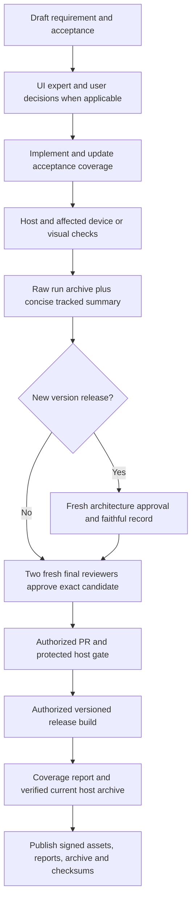

# Feature Specification: Verification, documentation and release maintenance

**Feature Branch**: `chore/existing-feature-specs` (retrospective documentation)

**Created**: 2026-10-16

**Status**: Backfilled contract for existing behavior; verification remains scoped in the
requirement map.

**Input**: Maintain a reproducible spec-driven project and publish reviewed builds with honest
coverage and evidence.

Uses the [Spec Kit-style template](../templates/spec.md). The [baseline](../../SPEC.md)
owns the complete numbered contract. IDs below refer to that baseline and are not
new feature-local requirements. This backfill adds no app behavior or test result.

## User Scenarios & Testing

### User Story 1 - Verify a change against requirements (Priority: P1)

Maintain a reproducible spec-driven project and publish reviewed builds with honest coverage and
evidence.

**Why this priority**: A pass must refer to the actual candidate and executed scope.

**Independent Test**: Edit a requirement/test mapping, run host gates and selected device suites,
inspect coverage and evidence.

**Acceptance Scenarios**:

1. **Given** an existing or changed feature, **When** a maintainer opens the feature index, **Then**
   its contract links to stable baseline IDs, mapped checks and gaps.
2. **Given** a behavior change, **When** implementation proceeds, **Then** spec precedes code,
   acceptance follows implementation, and every test edit refreshes checks/inventory/fingerprints.
3. **Given** a device/visual/performance claim, **When** evidence is recorded, **Then** it
   identifies configuration, source/build, timing/count denominators and unrun scope instead of
   treating mappings/assertion totals as complete coverage.
4. **Given** a new or different device, **When** the testing runbook is followed, **Then** host
   checks and explicit ADB serial select reproducible suites, with prerequisites and harness limits
   disclosed.

### User Story 2 - Review and distribute a release (Priority: P1)

Maintain a reproducible spec-driven project and publish reviewed builds with honest coverage and
evidence.

**Why this priority**: Publication requires trustworthy candidate and release evidence.

**Independent Test**: Validate exact-candidate approvals, version/tag/changelog, signed artifacts
and release-report inputs; inspect failure gates.

**Acceptance Scenarios**:

1. **Given** a final staged candidate, **When** push/release is requested, **Then** exactly two
   fresh independent agents explicitly approve the same digest before publication.
2. **Given** candidate contents change or approvals are missing/rejected, **When** publication is
   attempted, **Then** stale/missing approval records block it.
3. **Given** a PR targeting protected main, **When** required host checks or conversations are
   incomplete, **Then** merge remains blocked without bypass.
4. **Given** a matching release tag and successful gates, **When** release automation runs, **Then**
   signed APK/AAB, checksums, concise notes and linked Markdown/JSON coverage reports are attached.
5. **Given** invalid version/notes/signing/report evidence, **When** release automation runs,
   **Then** publication fails; published assets are not silently replaced.

### User Story 3 - Settle the experience before coding (Priority: P1)

**Why this priority**: Reduce avoidable UI rework without blocking exact authorized fixes.

**Independent Test**: Inspect the recorded expert proposal and consequential user
choices before implementation, then compare actual rendered acceptance separately.

**Acceptance Scenarios**:

1. **Given** an interaction change, **When** design is proposed, **Then** a UI expert
   compares the complete task for usability/friction and presents a concrete
   recommendation, states, tradeoffs and a sketch where placement/navigation changes.
2. **Given** a material undecided requirement after expert review, **When** work
   proceeds, **Then** the user is asked and dependent implementation waits; silence
   is not a choice and independent work can continue.
3. **Given** an exact authorized or delegated correction, **When** brief preflight
   finds no material decision, **Then** work proceeds without asking for the same approval.
4. **Given** implementation materially departs from the chosen flow, **When** the
   design changes, **Then** expert/user review is repeated before dependent work.

### User Story 4 - Find the system and its evidence (Priority: P2)

**Why this priority**: New maintainers need an entry route and readable design,
while raw evidence must remain retrievable without flooding source review.

**Independent Test**: Follow onboarding, render and inspect source-linked diagrams,
pack/verify a completed run, and inspect current-run release publication fault tests.

**Acceptance Scenarios**:

1. **Given** a new maintainer, **When** following onboarding, **Then** prerequisites,
   architecture/feature ownership, a first validation/change and review route are available.
2. **Given** changed ownership/navigation/state flow, **When** documentation is
   reconciled, **Then** high-level architecture and feature diagrams agree with
   code/contract and are rendered for readability review.
3. **Given** completed local or CI runs, **When** archived, **Then** bytes and
   per-file hashes are preserved outside new Git changes with concise scope,
   provenance, archive checksum/location, availability/retention and gaps in Git.
4. **Given** corrupt/missing/unsafe archive members, recursive output, source
   mutation or an existing archive, **When** pack/verify runs, **Then** verification
   fails without extracting content, deleting source evidence or silently overwriting it.
5. **Given** routine CI, **When** uploading evidence, **Then** only its own current
   run is included. An authorized release adds a durable current-run host archive;
   missing/mismatched source/report/member evidence blocks before publication APIs.

### User Story 5 - Consider architecture before coding (Priority: P1)

**Independent Test**: Walk through a local wording fix, a session ownership change
and uncertain IPC impact using the architecture map and expert skill.

**Acceptance Scenarios**:

1. Given an indexed feature, when planning a task, then its owners, overview and
   representative sequence are reachable without a broad source search.
2. Given possible or uncertain architecture impact, when planning implementation,
   then a fresh expert records affected invariants, failure paths, alternatives,
   test scope and an explicit verdict before dependent work.
3. Given a clearly local change, when screening it, then N/A has a reason; a
   material departure later triggers expert re-review. No diagrams count as tests.

### Edge Cases

- JVM/tooling pass rate, requirement mapping, device completion, visual approval and physical
  performance are separate measures.
- README stays concise; CHANGELOG owns release changes; raw versioned evidence keeps its original bytes.
- Local tests do not require publishing a branch; review records attest agent reviews and are not
  cryptographic authentication of agent identities.

## Requirements

### Functional Requirements

This maintenance contract changes no runtime behavior. Its existing baseline
quality and publication requirements follow.

### Non-Functional Requirements

- **NFR-001** (DX-PERF-001): Search, menu and input feedback have measured repeatable latency/frame
  baselines before performance claims.
- **NFR-002** (DX-VISUAL-001): UI expert preflight presents the intended experience,
  resolves material user decisions/unclear requirements before implementation and
  revisits departures. Actual rendered acceptance remains separate.
- **NFR-003** (DX-MAINT-001): Formatting, lint, build, host/tool tests and requirement links are
  repeatable locally and in CI. Device runners require raw final Android result status independently
  of ADB exit. Maintain developer onboarding and source-consistent high-level diagrams.
- **NFR-004** (DX-DOC-001): Concise setup/install/use README, separate changelog, indexed Spec
  Kit-style existing-feature contracts and portable testing runbook, and versioned evidence retain
  valid links and raw-log hashes. Future raw evidence is externally bundled with
  member/archive hashes; concise summaries/descriptors/locations remain in Git.
  Routine CI scopes artifacts to the current run and discloses retention/availability.
- **NFR-005** (DX-RELEASE-001): Tagged/manual GitHub release validates version/changelog, gates
  quality, signs and verifies APK/AAB with a persistent private key, attaches checksums and concise
  notes, and preserves published assets. A current-run raw host ZIP/descriptor is
  required and source/report/member-verified before publication. Official APK/AAB
  manifests and defined classes must exclude debug input/probe/instrumentation
  fixtures; package validation rejects diagnostic code before verified packaging.
- **NFR-006** (DX-COVERAGE-001): Every test change refreshes requirement-to-case coverage and source
  fingerprints; missing cases, unmapped entries and stale reports fail checks. Identical sources
  produce identical inventories across Windows/Linux path comparison and LF/CRLF checkout
  conventions.
- **NFR-007** (DX-REVIEW-001): Two fresh independent agents approve the same final candidate before
  pushing or releasing; content changes invalidate approvals.
- **NFR-008** (DX-REPORT-001): Every new release attaches a checksummed Markdown/JSON report with
  measured host pass rates, requirement coverage and gaps, unrun checks and version-specific
  changelog/release/workflow links. Invalid evidence blocks publication.
- **NFR-009** (DX-BRANCH-001): Main requires PRs, strict GitHub Actions host checks including two
  fresh agent approvals, administrator enforcement, resolved conversations and no force
  pushes/deletion.

- **NFR-013** (DX-ARCH-001): Source-linked whole-system/components and every feature
  owner retain overview/sequence diagrams. Every task screens impact; possible or
  uncertain architecture changes need a fresh expert approach review before
  dependent work. Resolve material questions, re-review departures and maintain
  source-consistent rendered diagrams separately from UI/final reviews.

### Key Entities

- **Requirement**: stable ID, acceptance, mapped checks, dimensions and explicit gap.
- **Candidate**: canonical Git content digest plus two actual fresh review records.
- **Release evidence**: current structured host results/coverage, signed assets, checksums and
  source/workflow links.

## Success Criteria

### Measurable Outcomes

- **SC-001**: Format/lint/build/JVM/tooling/coverage/documentation gates are runnable locally and in CI.
- **SC-002**: Changed tests cause coverage checking to fail until inventories are reconciled;
  identical sources have portable fingerprints/order.
- **SC-003**: Invalid/stale reviews or invalid required release evidence block publication; unrun
  device/visual/performance checks remain explicit.

## Assumptions

- Existing CI runs host checks, not physical-monitor suites; emulation does not certify cables,
  touch association or physical peripherals.
- Performance budgets remain proposed until controlled samples establish them; rendered review does
  not silently create goldens.

## Feature flow

Reviewed delivery and evidence. This is a product-level flow; implementation ownership is in
[architecture](../ARCHITECTURE.md) and the [owning code](../../tools/release.py).

## Verification and coverage

The linked entries contain concrete checks, scenario dimensions and current gaps.
They are mappings, not passes; use an identified run for execution evidence.

| Stable requirement | Scenario/test coverage |
| --- | --- |
| DX-PERF-001 / NFR-001 | [Checks and gaps](../coverage.md#dx-perf-001) |
| DX-VISUAL-001 / NFR-002 | [Checks and gaps](../coverage.md#dx-visual-001) |
| DX-MAINT-001 / NFR-003 | [Checks and gaps](../coverage.md#dx-maint-001) |
| DX-DOC-001 / NFR-004 | [Checks and gaps](../coverage.md#dx-doc-001) |
| DX-RELEASE-001 / NFR-005 | [Checks and gaps](../coverage.md#dx-release-001) |
| DX-COVERAGE-001 / NFR-006 | [Checks and gaps](../coverage.md#dx-coverage-001) |
| DX-REVIEW-001 / NFR-007 | [Checks and gaps](../coverage.md#dx-review-001) |
| DX-REPORT-001 / NFR-008 | [Checks and gaps](../coverage.md#dx-report-001) |
| DX-BRANCH-001 / NFR-009 | [Checks and gaps](../coverage.md#dx-branch-001) |

Run commands: [testing runbook](../TESTING.md). Visual/performance scope:
[quality strategy](../QUALITY.md). Shared UI: [design](../DESIGN.md).
Implementation ownership: [architecture](../ARCHITECTURE.md).
Return to the [feature index](README.md).

## Evidence privacy acceptance

- Given raw tracked test screenshots/logs, the host privacy gate fails.
- Given contaminated current host inputs, packaging/upload is withheld.
- Given safe current host reports, the guard permits existing packaging.
- Given explicit privacy withdrawal, unavailable evidence is not counted as verified;
  retained records still fail on missing, changed, duplicate or unsafe paths.

See [privacy boundary](../PRIVACY.md) and the stable privacy requirement mapping.

## Implementation diagrams

See the [component overview and representative sequence](../architecture/features/verification-and-release.md)
for source ownership, lifecycle/failure boundaries and current verification limits.

## Architecture approval for every release

- Given any new version candidate (including patch, prerelease or docs-only), after
  candidate checks/evidence, a fresh read-only architecture expert inspects the
  cumulative diff since the previous published release and current whole-product
  architecture, source, diagrams, known failures and verification gaps.
- Given a task-level N/A or earlier implementation architecture preflight, release
  architecture review is still required and cannot replace either final reviewer.
- Given missing approval or unresolved blockers, the agent must not create/push
  the release tag, dispatch release, sign or publish.
- Given the exact frozen pre-attestation snapshot, the record names actual reviewer,
  UTC date, version, prior release, scope, findings, verdict and residual gaps.
  Final reviewers verify that only faithful architecture attestation was added,
  then approve the final canonical digest including that record. Any other changed
  input needs renewed architecture review; final changes require a new final pair.
- Given an interrupted transport retry of the same version and byte-identical
  candidate, record its identity/retry reason before reusing the actual verdict.
  Never overwrite an already published release or weaken existing retry rules.

This is a required agent-session review, not a newly implemented CI judgment gate.
See [release procedure](../RELEASING.md#release-architecture-review).
