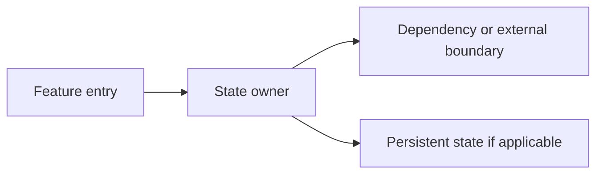
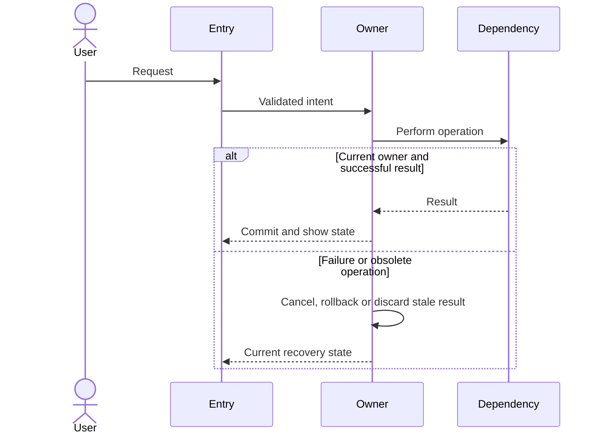

# Feature architecture: <name>

[System/component map](../architecture/README.md) | [Owning contract index](../specs/README.md)

## Scope and source

State implemented, intended, planned or debug-only scope; link the owning feature
contract/requirement IDs and current source files/symbols. List owners, persistent
vs session state, process/thread/trust boundaries and known verification gaps.

## Component overview

Replace all example nodes with actual owners. Label calls, callbacks, data and
frame paths distinctly; do not draw desired behavior as established implementation.

## Representative sequence

Explain which scenario is illustrated, omitted branches and linked sequences.
Identify cancellation, lifecycle/identity validation, rollback and teardown owners.

## Change and verification boundaries

List affected invariants, tests, compatibility/performance risks, actual evidence
and unverified scenarios. Record material expert decisions in the change plan/ADR.
Render and inspect diagrams; syntax success and diagrams are not runtime proof.
