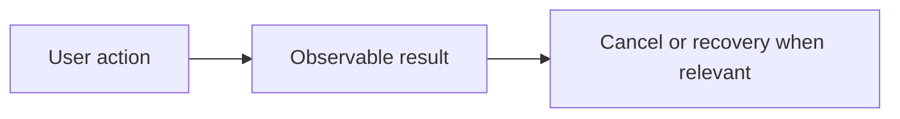

# Feature Specification: <feature name>

**Feature Branch**: `<branch>`

**Created**: <date>

**Status**: Draft

**Input**: <user need and intended outcome>

Adapted from the [GitHub Spec Kit template](https://github.com/github/spec-kit/blob/3238fa9285694dc539aeb9829b337bfd6aed7317/templates/spec-template.md).
Use product language here; implementation decisions belong in the technical plan
or architecture document. Keep the current `SPEC.md` and stable `DX-*` map reconciled.

## User Scenarios & Testing

### User Story 1 - <user outcome> (Priority: P1)

<An independently testable user journey. Add P2/P3 stories as needed.>

**Why this priority**: <value>

**Independent Test**: <observable demonstration>

**Acceptance Scenarios**:

1. **Given** <state>, **When** <action>, **Then** <observable result>.

### Edge Cases

- <Boundary, failure, interrupted state, and expected behavior.>

## Experience review

- UI expert/proposal and settled material user decision (or N/A for non-UI work):
- Open requirements requiring clarification before dependent implementation:
- Representative states/flow; use product language, with technical ownership linked
  to architecture or the change plan:

Replace this example with the feature's meaningful high-level flow; do not add a
class dump. Exact small fixes can reference an unchanged existing flow. See
[WORKFLOW](../WORKFLOW.md) for proposal scope and [ONBOARDING](../ONBOARDING.md).

## Architecture links

Link the feature overview and sequence in `docs/architecture/features/` using
[the architecture template](feature-architecture.md). Keep technical ownership
there and observable acceptance here. Record architectural impact and expert
review in the change plan before dependent implementation.

## Requirements

### Functional Requirements

- **FR-001**: <Required behavior; associate a stable DX ID.>

### Key Entities

- **<Entity>**: <User-relevant data and relationships, when applicable.>

## Success Criteria

### Measurable Outcomes

- **SC-001**: <Technology-independent, measurable pass condition.>

## Assumptions

- <Dependencies, scope boundaries and explicit deferred behavior.>
